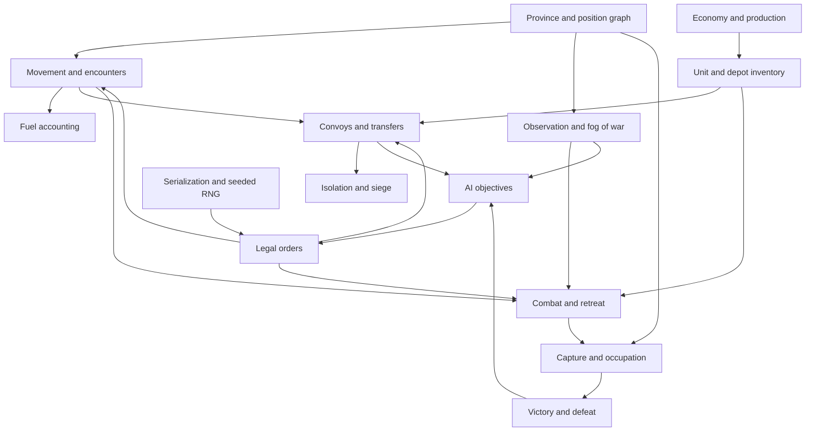

# Systems dependency audit

## Critical dependency graph

## Resolve in this order

1. Identifiers, graph connectivity, data schema and invariants.
2. Turn input, order validation, deterministic state transition, event log and save.
3. Position movement, fuel, encounter detection and route access.
4. Inventory transfers, storage limits, convoy timing and delivery throughput.
5. Recon/visibility, weapon eligibility, firing budget, damage, morale and retreat.
6. Occupation, siege/isolation, victory/defeat.
7. Production, manpower, repair and automation.
8. AI planner, mobile UX and complete campaign balancing.

## Integration seams most likely to break

- **Movement → supply:** route access is evaluated at a consistent phase; no retrospective deliveries.
- **Interdiction → transfer:** destroyed cargo cannot arrive; interception logs must reconcile stock.
- **Combat → occupation:** control progress cannot advance while eligible enemies contest the position.
- **Occupation → logistics:** control of administrative centre does not grant all transport edges.
- **Combat → morale:** lack of provisions causes staged readiness/morale effects, not instant HP deletion.
- **Repair → equipment:** destroyed objects cannot be recreated by condition restoration.
- **AI → fog:** AI planning consumes only its observation view, not omniscient world state.
- **Task forces → units:** grouped orders do not merge cargo, personnel or ammunition.
- **Save → RNG:** seed and pending events are serialized, so reload cannot reroll battle outcomes.

## Change control

A rule change requires updating decision register, rules specification, tests and (when applicable) save schema. The engine remains authoritative; UI is presentation and command entry only.
